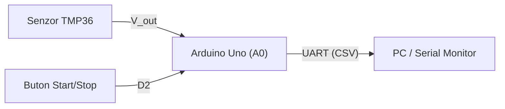

Proiect de laborator pentru disciplina Achizita si Prelucrarea Datelor
Nod de achizitie a temperaturii bazat pe Arduino Uno
##Autor
##Hardware
Arduino Uno R3, senzor de temperatura TMP36
echo "Platformă: Arduino Uno R3 (ATmega328P)"
echo "Autor laborator: <Irimia Bogdan Stefan>

## Parametri

SENSOR_PIN A0 // intrarea analogică a senzorului
SAMPLE_PERIOD_MS 1000 // compromis: 1 s (consum redus)
SERIAL_BAUD 9600 // viteza portului serial
LED_PIN 13 // LED de stare
BUTTON_PIN 2 //buton de pornire/oprie achizitie
SAMPLE_PERIOD_MS 500
Comunicatie seriala la 115200 baud

# Sistem de achiziție și monitorizare a temperaturii (APD)
Proiect de laborator pentru achiziția semnalelor analogice, filtrarea numerică și
transmiterea datelor pe interfața serială UART.
## 1. Arhitectura sistemului

## 2. Alocarea pinilor (Pinout)
| Componentă | Pin Arduino | Configurație | Rol |
| :--- | :---: | :---: | :--- |
| Senzor TMP36 | `A0` | Intrare analogică | Măsurare temperatură |
| Buton control | `D2` | `INPUT_PULLUP` | Activare / oprire eșantionare |
| LED Stare | `D13` | `OUTPUT` | Semnalizare achiziție activă |
## 3. Relația de conversie
Pentru senzorul TMP36 ($500\text{ mV}$ offset la $0^\circ\text{C}$, pantă $10\text{
mV}/^\circ\text{C}$), temperatura în grade Celsius se calculează cu relația:
$$T(^\circ\text{C}) = \left( \frac{D_{ADC} \cdot 5.0}{1023.0} - 0.5 \right) \cdot 100$$
## 4. Formatul datelor transmise (CSV)
```text
timestamp_ms,raw_adc,voltage_v,temp_c
1000,153,0.75,24.78
2000,155,0.76,25.76
```
## 5. Checklist verificare
- [x] Configurare repository și `.gitignore`
- [x] Redactare specificație hardware în Markdown
- [ ] Simulare circuit în Tinkercad Circuits
